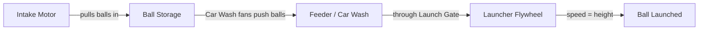
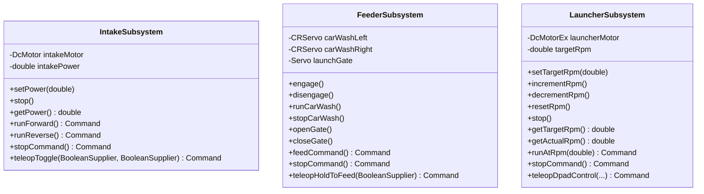

# BioBuzz — Waldon Robotics 12862 Project Documentation

> [!NOTE]
> **Robot:** BioBuzz · **Team:** Waldon Robotics #12862 · **Season:** FTC 2026-2027
> **Repo:** [WaldonRobotics12862/Pedro-Pathing-Quickstart](https://github.com/WaldonRobotics12862/Pedro-Pathing-Quickstart) · **Branch:** `main`

---

## Robot Overview

BioBuzz is a ball-launching FTC robot built on a **mecanum drivetrain** with a **SparkFun OTOS** sensor for odometry.  The game mechanism pipeline is:



| System | What it does |
|---|---|
| **Drivetrain** | 4-wheel mecanum, field-centric drive via Pedro Pathing |
| **Intake** | Single motor pulls balls into on-board storage |
| **Feeder (Car Wash)** | Two vertical CR servos push stored balls toward the launcher |
| **Launch Gate** | Servo gate controls ball flow into the launcher |
| **Launcher** | Flywheel motor; RPM controls launch height/distance |
| **Localizer** | SparkFun OTOS with custom heading negation for sensor orientation |

---

## Hardware Map — `biobuzz.xml`

Configuration file: `TeamCode/src/main/res/xml/biobuzz.xml`

### Expansion Hub 2 (port 2)

| Port | Type | Device Name | Purpose |
|---|---|---|---|
| Motor 0 | goBILDA 5202 | `Front Left` | Drivetrain |
| Motor 1 | goBILDA 5202 | `Back Left` | Drivetrain |
| Motor 3 | goBILDA 5202 | `IntakeMotor` | Intake system |
| Servo 2 | CR Servo | `Car Wash Left` | Feeder fan (left) |
| Servo 4 | Servo | `Launch Gate` | Ball gate |

### Control Hub (port 173)

| Port | Type | Device Name | Purpose |
|---|---|---|---|
| Motor 0 | goBILDA 5202 | `Front Right` | Drivetrain |
| Motor 1 | goBILDA 5202 | `Back Right` | Drivetrain |
| Motor 3 | goBILDA 5202 | `LauncherMotor` | Ball launcher flywheel |
| Servo 0 | CR Servo | `Car Wash Right` | Feeder fan (right) |
| I2C Bus 1 | SparkFun OTOS | `otos` | Odometry / localization |

> [!TIP]
> The old robot config is preserved in `TeamCode/src/main/res/xml/biobuzz_old_robot.xml` for reference. It only had 4 drive motors + OTOS (no intake/feeder/launcher).

---

## Project Structure

```
TeamCode/src/main/java/org/firstinspires/ftc/teamcode/
├── ExampleTeleOp.java              ← Main driver-controlled OpMode
├── AutonTest.java                  ← Basic autonomous (bezier path test)
├── AutonTestDiego.java             ← Diego's autonomous variant
├── AutonTestIshaan.java            ← Ishaan's autonomous variant
├── AutonTestNischay.java           ← Nischay's autonomous variant
├── AutonTestSahas.java             ← Sahas's autonomous variant
├── AutonTest_Sahas.java            ← Sahas's autonomous variant (alt)
├── AutoPath2.java                  ← Autonomous path to (15, 30)
├── AutoPath3.java                  ← Autonomous path to (40, 10)
├── subsystems/
│   ├── IntakeSubsystem.java        ← Intake motor control + Ivy commands
│   ├── FeederSubsystem.java        ← Car Wash + Launch Gate + Ivy commands
│   └── LauncherSubsystem.java      ← Launcher flywheel RPM + Ivy commands
└── pedro/
    ├── Constants.java              ← Drivetrain, OTOS, Foresight config
    ├── WaldonOTOSLocalizer.java    ← Custom OTOS (negated heading fix)
    ├── Tuning.java                 ← Pedro auto-tuning entry point
    └── procedures/                 ← 9 tuning procedure classes
        ├── ForesightTuner.java
        ├── MecanumTuner.java
        ├── OTOSTuner.java
        ├── OctoQuadTuner.java
        ├── PinpointTuner.java
        ├── Tests.java
        ├── ThreeWheelIMUTuner.java
        ├── ThreeWheelTuner.java
        └── TwoWheelTuner.java
```

---

## Subsystem Architecture

Each mechanism subsystem follows a consistent pattern with two API layers:



### Layer 1 — Low-Level Methods

Direct hardware control methods usable from anywhere (autonomous routines, custom commands, testing):

| Subsystem | Key Methods |
|---|---|
| **IntakeSubsystem** | `setPower(double)`, `stop()`, `getPower()` |
| **FeederSubsystem** | `engage()`, `disengage()`, `openGate()`, `closeGate()`, `runCarWash()`, `stopCarWash()` |
| **LauncherSubsystem** | `setTargetRpm(double)`, `incrementRpm()`, `decrementRpm()`, `resetRpm()`, `stop()` |

### Layer 2 — Ivy Command Factories

Return composable `Command` objects for the Ivy scheduler:

| Subsystem | Reusable Commands | TeleOp Commands |
|---|---|---|
| **Intake** | `runForward()`, `runReverse()`, `stopCommand()` | `teleopToggle(aBtn, bBtn)` |
| **Feeder** | `feedCommand()`, `stopCommand()` | `teleopHoldToFeed(button)` |
| **Launcher** | `runAtRpm(rpm)`, `stopCommand()` | `teleopDpadControl(up, down, left, right)` |

---

## TeleOp Controls

`ExampleTeleOp.java` — registered as `"Example TeleOp"`

### Gamepad 1 — Driver (Drivetrain)

| Control | Action |
|---|---|
| Left Stick | Translate (field-centric) |
| Right Stick X | Rotate |
| A Button | Calibrate IMU |

### Gamepad 2 — Operator (Mechanisms)

| Control | Action |
|---|---|
| **A** (toggle) | Intake forward ON / OFF |
| **B** (toggle) | Intake reverse ON / OFF |
| **D-Pad Up** | Launcher: start at 1450 RPM or +50 RPM |
| **D-Pad Down** | Launcher: −50 RPM |
| **D-Pad Left** | Launcher: reset to 1450 RPM |
| **D-Pad Right** | Launcher: stop (0 RPM) |
| **Left Bumper** (hold) | Feed: open gate + run car wash |

---

## Pedro Pathing Configuration

Configured in `pedro/Constants.java`:

### Mecanum Drivetrain
- **Motor directions:** Front Left & Back Left = `FORWARD`, Front Right & Back Right = `REVERSE`

### OTOS Localizer
- **Sensor:** SparkFun OTOS on I2C bus 1
- **Linear scalar:** `1.036`
- **Angular scalar:** `0.9976`
- **Offset:** `(-1.418, -0.216)` inches
- **Custom heading fix:** `WaldonOTOSLocalizer` negates the heading to correct for sensor mounting orientation

### Foresight Path Following (tuned values)
| Parameter | Value |
|---|---|
| Max forward velocity | 88.74 in/s |
| Max strafe velocity | 72.78 in/s |
| Natural forward deceleration | 36.79 in/s² |
| Natural strafe deceleration | 78.86 in/s² |
| Heading feedback | 0.432 (proportional) |

---

## Launcher Constants

| Constant | Value | Notes |
|---|---|---|
| `TICKS_PER_REV` | `28.0 × 3.7 = 103.6` | goBILDA 5202 encoder × 3.7:1 gearbox |
| `START_RPM` | `1450` | Default starting RPM |
| `RPM_STEP` | `50` | Increment per D-pad press |
| `MAX_RPM` | `6000` | Safety cap |

> [!IMPORTANT]
> Launcher speed directly controls ball launch height. Higher RPM = higher arc. The velocity PID (`RUN_USING_ENCODER`) on the motor handles maintaining consistent RPM under load.

---

## Feeder Constants

| Constant | Value |
|---|---|
| `GATE_OPEN` | `0.0` (servo position) |
| `GATE_CLOSED` | `1.0` (servo position) |
| Car Wash Left power | `-1.0` (when feeding) |
| Car Wash Right power | `+1.0` (when feeding) |

---

## Autonomous OpModes

| OpMode | Registered Name | Path |
|---|---|---|
| `AutonTest` | `"Auton Test"` | Bezier (0,0) → (50,50) |
| `AutonTestDiego` | `"Auton Test Diego"` | Bezier (0,0) → (50,50) |
| `AutonTestIshaan` | `"Auton Test Ishaan"` | Bezier (0,0) → (50,50) |
| `AutonTestNischay` | `"Auton Test Nischay"` | Bezier (0,0) → (50,50) |
| `AutonTestSahas` | `"Auton Test Sahas"` | Bezier (0,0) → (50,50) |
| `AutonTest_Sahas` | `"Auton Test Sahas_"` | Bezier (0,0) → (50,50) |
| `AutoPath2` | `"Auto Path 2"` | Bezier (0,0) → (15,30) |
| `AutoPath3` | `"Auto Path 3"` | Bezier (0,0) → (40,10) |

> [!NOTE]
> The per-member autonomous tests (Diego, Ishaan, Nischay, Sahas) are individual sandboxes for team members to experiment with autonomous paths independently. They currently all use the same basic bezier curve but are intended to diverge as members develop their own routines.

---

## Dependencies

| Library | Version | Purpose |
|---|---|---|
| `com.pedropathing:core` | 3.0.2 | Pedro Pathing core (paths, followers, algorithms) |
| `com.pedropathing:revhub` | 3.0.2 | REV Hub hardware integration (Mecanum, OTOS, etc.) |
| `com.pedropathing.ivy:core` | 1.1.1 | Ivy command framework (Command, Scheduler, Groups) |
| `com.pedropathing.ivy:pedro` | 1.1.1 | Ivy-Pedro integration (PedroCommands) |
| `com.pedropathing:tuning` | 1.0.3 | Auto-tuning procedures |
| `com.acmerobotics.dashboard:dashboard` | 0.4.16 | FTC Dashboard & AdvantageScope live telemetry streaming |

---

## Ivy Command Framework — Quick Reference

The project uses **Pedro Pathing Ivy** for command-based robot control.

| Pattern | Usage |
|---|---|
| `Commands.infinite(runnable)` | Runs forever until interrupted (teleop loops) |
| `Commands.instant(runnable)` | Runs once immediately |
| `Commands.waitMs(ms)` | Waits a duration |
| `Commands.waitUntil(condition)` | Waits until condition is true |
| `new CommandBuilder()` | Custom command with `.setStart()`, `.setExecute()`, `.setDone()`, `.setEnd()` |
| `.requiring(objects...)` | Declares resource requirements for conflict resolution |
| `Groups.sequential(cmds...)` | Runs commands in sequence |
| `Groups.parallel(cmds...)` | Runs commands simultaneously |
| `Groups.race(cmds...)` | Runs until first finishes |
| `Scheduler.schedule(cmds...)` | Schedules commands for execution |
| `Scheduler.execute()` | Ticks all scheduled commands (call in `loop()`) |

---

*Last updated: 2026-11-07*
