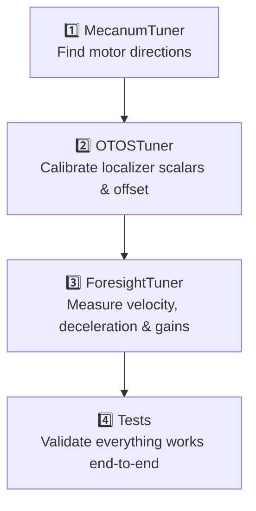

# Pedro Pathing Quick Start Guide

A practical guide to defining robot moves and creating autonomous paths using the **Pedro Pathing** library in this FTC project.

---

## Table of Contents

1. [Project Structure](#project-structure)
2. [How Poses Are Defined](#how-poses-are-defined)
3. [How Paths Are Created](#how-paths-are-created)
4. [Building an Autonomous Routine](#building-an-autonomous-routine)
5. [Robot Configuration (Constants)](#robot-configuration-constants)
6. [Tuning Your Robot](#tuning-your-robot)

---

## Project Structure

All team-specific code lives under:

```
TeamCode/src/main/java/org/firstinspires/ftc/teamcode/
├── AutonTest.java           ← Example autonomous OpMode
└── pedro/
    ├── Constants.java       ← Drivetrain, localizer & controller config
    ├── Tuning.java          ← Tuning procedure registry
    └── procedures/
        ├── MecanumTuner.java    ← Motor direction tuning
        ├── OTOSTuner.java       ← OTOS localizer calibration
        ├── ForesightTuner.java  ← Path-following controller tuning
        └── Tests.java           ← Validation tests
```

---

## How Poses Are Defined

A **Pose** represents the robot's position and heading on the field (x, y, heading in degrees or radians).

### Creating a `PoseFactory`

```java
// Angles specified in degrees (most human-readable)
private final PoseFactory poseFactory = PoseFactory.degrees();
```

### Defining Waypoints

```java
// poseFactory.of(x, y, headingDegrees)
private final Pose start       = poseFactory.of(56,      8,      90);
private final Pose path1       = poseFactory.of(56,      36,     180);
private final Pose point2      = poseFactory.of(94.1752, 12.2781, 90.6797);
```

| Parameter | Unit   | Description                              |
|-----------|--------|------------------------------------------|
| `x`       | inches | Horizontal position on the field         |
| `y`       | inches | Vertical position on the field           |
| `heading` | degrees (with `PoseFactory.degrees()`) | Robot facing direction |

### Control Points (for Curves)

Bezier curves require intermediate **control points** that shape the arc. These are also defined as `Pose` objects, but their heading is typically `0` because only their position is used for the curve geometry:

```java
private final Pose point2Control1  = poseFactory.of(94.1383,  31.5257, 0);
private final Pose point3Control1  = poseFactory.of(131.4839, 125.3087, 0);
private final Pose point3Control2  = poseFactory.of(88.8585,  120.5273, 0);
```

---

## How Paths Are Created

Paths are built using static factory methods on the `Paths` class (imported with `import static com.pedropathing.api.Paths.*`).

### 1. Straight Line

```java
// Paths.line(startPose, endPose)
public Path path1() {
    return Paths.line(start, path1).linear(start, path1);
}
```

- `.linear(start, end)` — interpolates the robot's heading linearly from the start heading to the end heading along the line.

### 2. Quadratic Bezier Curve (one control point)

```java
// Paths.curve(start, controlPoint1, end)
public Path path2() {
    return Paths.curve(path1, point2Control1, point2).reverseTangent();
}
```

- **One control point** bends the path in a smooth arc.

### 3. Cubic Bezier Curve (two control points)

```java
// Paths.curve(start, controlPoint1, controlPoint2, end)
public Path path3() {
    return Paths.curve(point2, point3Control1, point3Control2, point3).reverseTangent();
}
```

- **Two control points** give you an S-curve or more complex shape.

### Path Modifiers

| Modifier           | Description                                                                 |
|--------------------|-----------------------------------------------------------------------------|
| `.reverseTangent()` | Robot drives **backwards** along the path (robot faces away from direction of travel) |
| `.linear(start, end)` | Linearly interpolates robot heading from start to end along the path     |

> [!TIP]
> Use `.reverseTangent()` whenever your robot needs to approach a scoring position rear-first, avoiding a multi-point turn.

---

## Building an Autonomous Routine

Autonomous routines are composed as a **sequential command** using Pedro's `Scheduler` / `Ivy` command framework.

### Full Example ([`AutonTest.java`](file:///C:/Users/rahul/git/WaldonRobotics12862/Pedro-Pathing-Quickstart/TeamCode/src/main/java/org/firstinspires/ftc/teamcode/AutonTest.java))

```java
@Autonomous
public class AutonTest extends LinearOpMode {

    private Follower follower;
    private final PoseFactory poseFactory = PoseFactory.degrees();

    // 1. Define all waypoints
    private final Pose start  = poseFactory.of(56, 8, 90);
    private final Pose path1  = poseFactory.of(56, 36, 180);
    // ... more poses ...

    // 2. Compose the routine as sequential path-follows
    public Command autoRoutine() {
        return sequential(
                follow(follower, path1()),
                follow(follower, path2()),
                follow(follower, path3())
                // add more paths here
        );
    }

    @Override
    public void runOpMode() {
        // 3. Reset scheduler & create the follower from Constants
        Scheduler.reset();
        follower = Constants.create(hardwareMap);
        follower.setPose(start);   // set starting position
        follower.update();

        waitForStart();
        schedule(autoRoutine());   // 4. Schedule the routine

        while (opModeIsActive()) {
            follower.update();     // 5. Must call every loop
            Scheduler.execute();   // 6. Advances the command queue

            // Optional telemetry
            telemetry.addData("x", follower.pose().x());
            telemetry.addData("y", follower.pose().y());
            telemetry.addData("heading", follower.pose().heading());
            telemetry.update();
        }
    }

    // 7. Declare each path as its own method
    public Path path1() {
        return Paths.line(start, path1).linear(start, path1);
    }
    public Path path2() {
        return Paths.curve(path1, point2Control1, point2).reverseTangent();
    }
    // ...
}
```

### Key Steps Summary

| Step | What it does |
|------|-------------|
| `Constants.create(hardwareMap)` | Builds the `Follower` with your configured localizer, drivetrain, and controller |
| `follower.setPose(start)` | Tells the localizer where the robot begins |
| `schedule(autoRoutine())` | Queues the full sequential path plan |
| `follower.update()` | Re-reads sensor data and updates path tracking — **call every loop** |
| `Scheduler.execute()` | Advances the command queue (runs the next step when the current one is done) |

---

## Robot Configuration ([`Constants.java`](file:///C:/Users/rahul/git/WaldonRobotics12862/Pedro-Pathing-Quickstart/TeamCode/src/main/java/org/firstinspires/ftc/teamcode/pedro/Constants.java))

All hardware and controller constants live in `Constants.java`.

### Drivetrain Config

```java
public static MecanumConfig drivetrainConfig = new MecanumConfig(c -> {
    c.frontLeftName.set("Front Left");
    c.frontRightName.set("Front Right");
    c.backLeftName.set("Back Left");
    c.backRightName.set("Back Right");
    c.frontLeftDirection.set(DcMotorSimple.Direction.FORWARD);
    // ...
});
```

> [!IMPORTANT]
> Motor names must **exactly match** your robot's hardware configuration file on the Driver Station.

### Localizer Config (OTOS)

```java
public static OTOSConfig localizerConfig = new OTOSConfig(c -> {
    c.name.set("otos");               // HardwareMap name
    c.linearScalar.set(1.1573...);    // Calibrated via OTOSTuner
    c.angularScalar.set(0.9915...);   // Calibrated via OTOSTuner
    c.offset.set(new Pose(-0.306..., 0.282...)); // Sensor offset from robot center
    c.linearUnit.set(DistanceUnit.INCH);
});
```

### Foresight Controller Config

The **Foresight** algorithm computes optimal drive powers along the path. Its parameters are automatically generated by the `ForesightTuner`:

```java
public static ForesightConfig foresightConfig = new ForesightConfig(c -> {
    // Proportional feedback for correcting position error
    c.forwardTranslational.set(...);
    c.strafeTranslational.set(...);

    // Velocity feedforward (coast = mid-path, brake = end-of-path)
    c.coast.set(Controller.proportionalFeedforward(...));
    c.brake.set(Controller.proportionalFeedforward(...));

    // Heading correction
    c.headingFeedback.set(Controller.proportional(...));

    // Physical robot characteristics (measured by tuners)
    c.maxAchievableForwardVelocity.set(85.13...);
    c.maxAchievableStrafeVelocity.set(70.43...);
    c.naturalForwardDeceleration.set(24.31...);
    c.naturalStrafeDeceleration.set(63.42...);
});
```

---

## Tuning Your Robot

Before running autonomous paths, calibrate your robot using the tuners registered in [`Tuning.java`](file:///C:/Users/rahul/git/WaldonRobotics12862/Pedro-Pathing-Quickstart/TeamCode/src/main/java/org/firstinspires/ftc/teamcode/pedro/Tuning.java).

### Recommended Tuning Order



### 1. Mecanum Tuner

Spins each motor one at a time and asks you if it spun forward or reversed. Updates `MecanumConfig` in `Constants.java`.

```
OpMode: Tuning → mecanumTuner
```

### 2. OTOS Tuner

Calibrates the **SparkFun OTOS** optical tracking sensor:
- **Linear scalar** — push robot a known distance, measures scale error
- **Angular scalar** — spin robot N full rotations, measures angle drift  
- **XY offset** — rotate robot 180° in place to find sensor offset from center

```
OpMode: Tuning → otosTuner
```

### 3. Foresight Tuner

Automatically characterizes your robot's motion by running a series of drive tests:
- Max forward / strafe velocity
- Natural deceleration (forward & strafe)
- Heading braking coefficients
- Linear braking coefficients
- Translational PID gains

At the end it prints ready-to-paste Java code for `ForesightConfig`.

```
OpMode: Tuning → foresightTuner
```

> [!NOTE]
> The `ForesightTuner` runs multiple OpModes sequentially. Give the robot space — at least 48 inches in front and to the sides.

### 4. Tests

Runs validation tests to confirm the tuned constants produce accurate motion before you write full autonomous paths.

```
OpMode: Tuning → tests
```

---

## Quick Reference: Path Building Cheat Sheet

```java
import static com.pedropathing.api.Paths.*;
import static com.pedropathing.ivy.commands.Commands.*;
import static com.pedropathing.ivy.groups.Groups.sequential;
import static com.pedropathing.ivy.pedro.PedroCommands.follow;

// Straight line, heading interpolated
Paths.line(a, b).linear(a, b)

// Straight line, robot drives backwards
Paths.line(a, b).reverseTangent()

// Smooth curve (quadratic Bezier) — robot faces forward
Paths.curve(start, ctrl1, end)

// Smooth curve — robot drives backwards
Paths.curve(start, ctrl1, end).reverseTangent()

// S-curve (cubic Bezier) — robot drives backwards
Paths.curve(start, ctrl1, ctrl2, end).reverseTangent()

// Compose multiple paths in order
sequential(
    follow(follower, path1()),
    follow(follower, path2()),
    follow(follower, path3())
)
```
